# دليل لوحة الإدارة

**آخر تحديث:** 23 نوفمبر 2026 (الخطوة هـ-٢: لوحة الإدارة)

اللوحة على نفس عنوان المنصة، تحت `/admin`. تدخل برقم جوالك ورمز التحقق مثل أي مستخدم، والمنصة تعرف إنك موظف وتوديك للوحة. **كل موظف يشوف بس الأقسام اللي تخص دوره**، وأي إجراء تسويه ينكتب باسمك في سجل الإجراءات.

في الكمبيوتر الأقسام في القائمة الجانبية. وفي الجوال تلقاها تحت الأرقام في أول صفحة («بانتظارك»).

## الأدوار ووش يشوف كل واحد

هذا الجدول **الافتراضي**. المالك يقدر يغيّره من شاشة «الصلاحيات» (القسم ١٠) بدون مبرمج.

| القسم | المالك | مدير عام | موظف توثيق | خدمة عملاء | مالية |
| --- | --- | --- | --- | --- | --- |
| توثيق المزوّدين والبائعين، وفتح المستندات | ✓ | ✓ | ✓ | | |
| قائمة المزوّدين (بدون المستندات) | ✓ | ✓ | ✓ | ✓ | |
| العملاء | ✓ | ✓ | ✓ | ✓ | |
| رقم هوية الفرد كامل وتأكيدها | ✓ | ✓ | ✓ | | |
| البلاغات | ✓ | ✓ | | ✓ | |
| إخفاء منتج مخالف | ✓ | ✓ | | ✓ | |
| الاشتراكات والدفعات | ✓ | ✓ | | | ✓ |
| سعر الباقات | ✓ | ✓ | | | |
| الأرقام | ✓ | ✓ | | | ✓ |
| إيقاف مزوّد أو بائع | ✓ | ✓ | | | |
| طلبات حذف الحساب | ✓ | ✓ | | | |
| الإعدادات | ✓ | ✓ | | | |
| الموظفين | ✓ | ✓ (ما عدا المدير العام) | | | |
| سجل الإجراءات | ✓ | ✓ | | | |
| **تغيير العمولة** | ✓ | | | | |
| **تغيير الصلاحيات** | ✓ | | | | |

## ١. بانتظارك (أول صفحة)

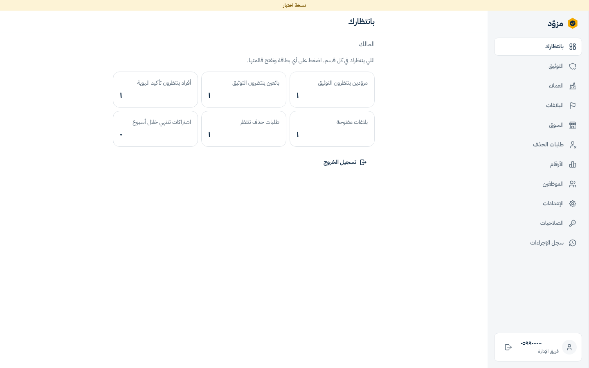

بطاقة لكل قسم يخصك، فيها عدد اللي ينتظر: مزوّدين وبائعين ينتظرون التوثيق، وأفراد ينتظرون تأكيد الهوية، وبلاغات مفتوحة، وطلبات حذف، واشتراكات تنتهي خلال أسبوع. **اضغط على البطاقة وتفتح قائمتها.** لو كل الأرقام صفر يطلع لك «ما فيه شي ينتظرك الحين».

في الجوال:

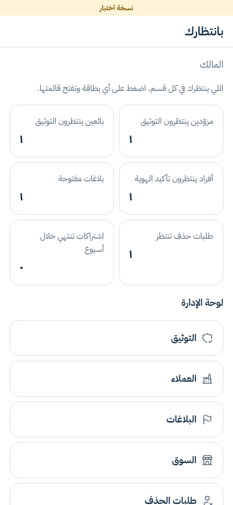

## ٢. التوثيق

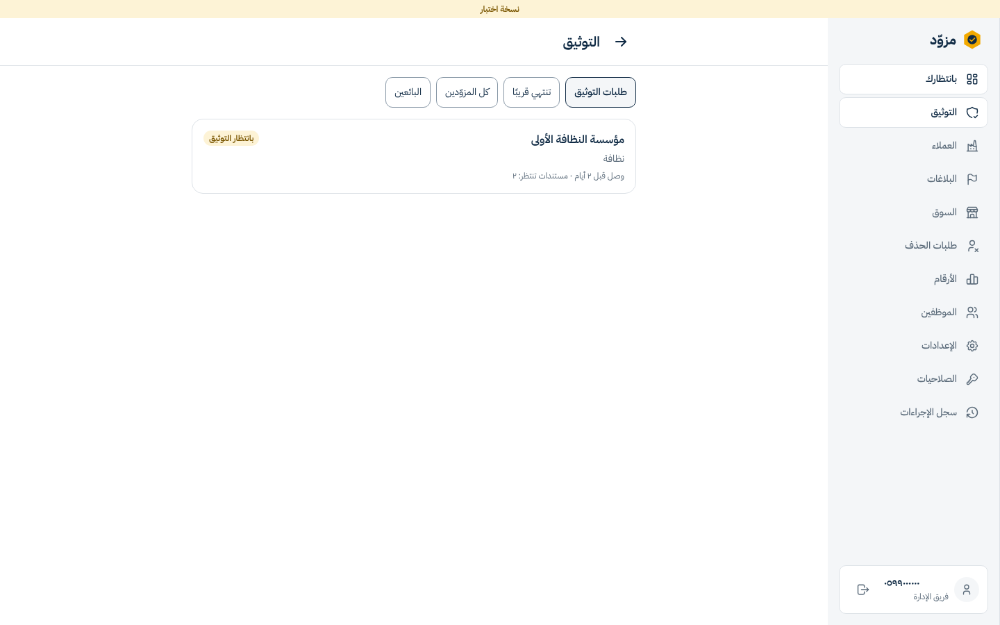

أربع قوائم:
- **طلبات التوثيق:** مزوّدين أرسلوا مستنداتهم، أو مزوّد موثّق رفع نسخة مجدّدة (شارة «تجديد»). **الأقدم فوق**.
- **تنتهي قريبًا:** مستندات مزوّدين موثّقين تنتهي خلال ٣٠ يوم أو انتهت.
- **كل المزوّدين:** كل مزوّد وحالته.
- **البائعين:** المصانع اللي فعّلت البيع في السوق، واللي ينتظر التوثيق أول.

### مراجعة مزوّد

اضغط على اسمه. تطلع بياناته ومستنداته. لكل مستند: «افتح المستند» (رابط مؤقت ٥ دقايق، والفتح ينسجل)، وأشّر على **كل** بنود قائمة التحقق، وبعدها «اقبل» أو اكتب السبب و«ارفض». بعد قبول كل المستندات: «وثّق المزوّد».

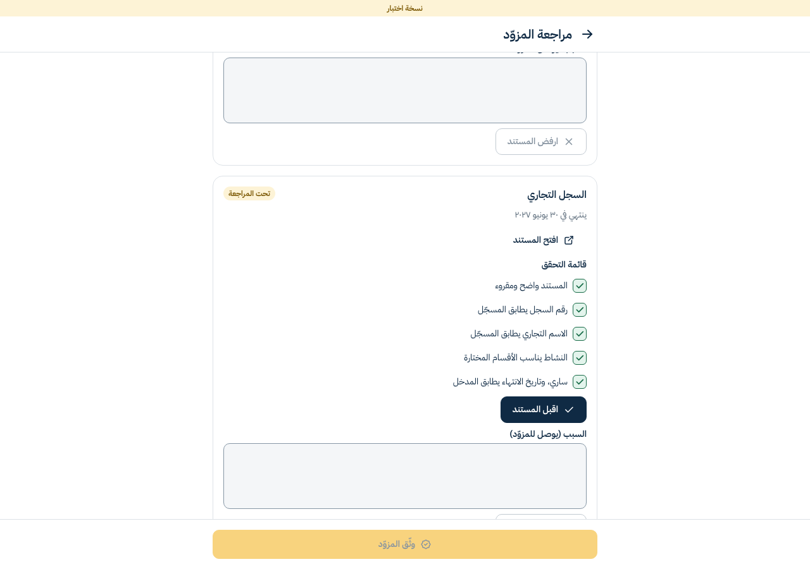

الخطوات في [`procedures/verify-provider.md`](procedures/verify-provider.md).

### مراجعة بائع

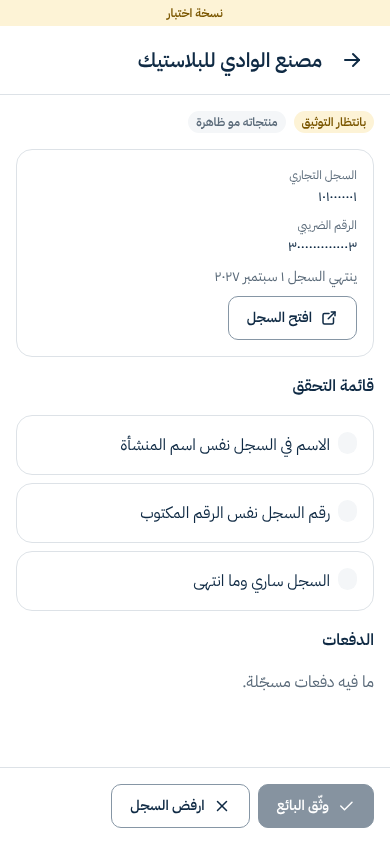

«افتح السجل»، وأشّر على البنود الثلاثة (الاسم، والرقم، والسريان)، وبعدها «وثّق البائع» أو «ارفض السجل» مع السبب. منتجاته تظهر في السوق بس لما يكون **موثّق، وسجله ساري، واشتراكه ساري**. الخطوات في [`procedures/verify-seller.md`](procedures/verify-seller.md).

## ٣. العملاء

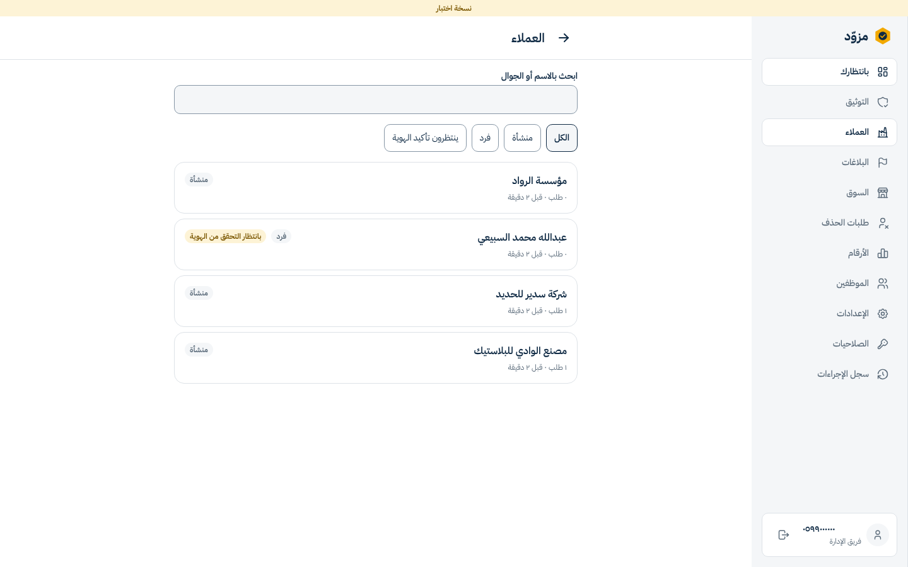

ابحث بالاسم أو جزء من الجوال، أو صفّي: منشأة، أو فرد، أو «ينتظرون تأكيد الهوية».

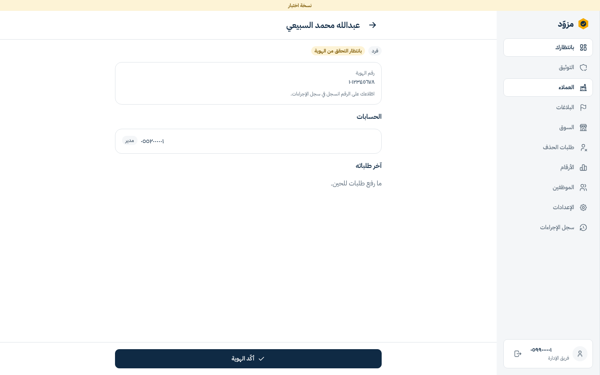

صفحة العميل فيها بياناته، وحساباته، وآخر طلباته. **رقم هوية الفرد** يطلع كامل لموظف التوثيق والمدير والمالك بس (واطلاعك ينسجل)، ولخدمة العملاء يطلع مخفي. زر **«أكّد الهوية»** لتأكيدها يدويًا لين يجهز الربط مع «نفاذ». الخطوات في [`procedures/verify-individual-identity.md`](procedures/verify-individual-identity.md).

## ٤. البلاغات

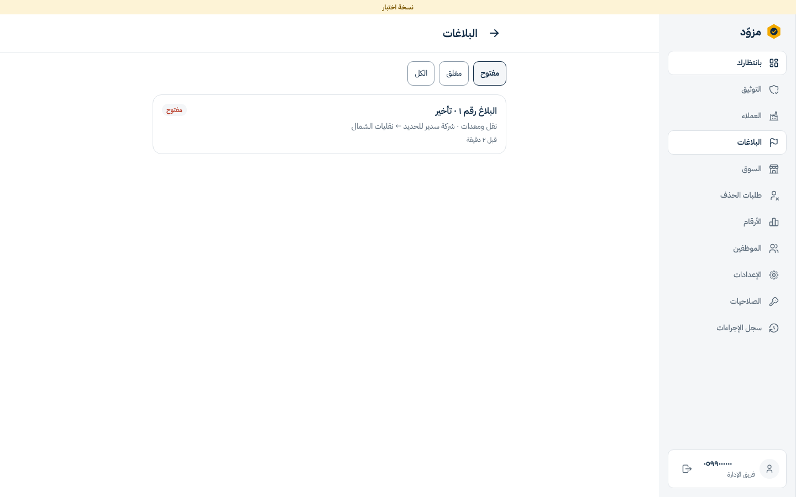

المفتوحة أول، والأقدم أول. اضغط على البلاغ:

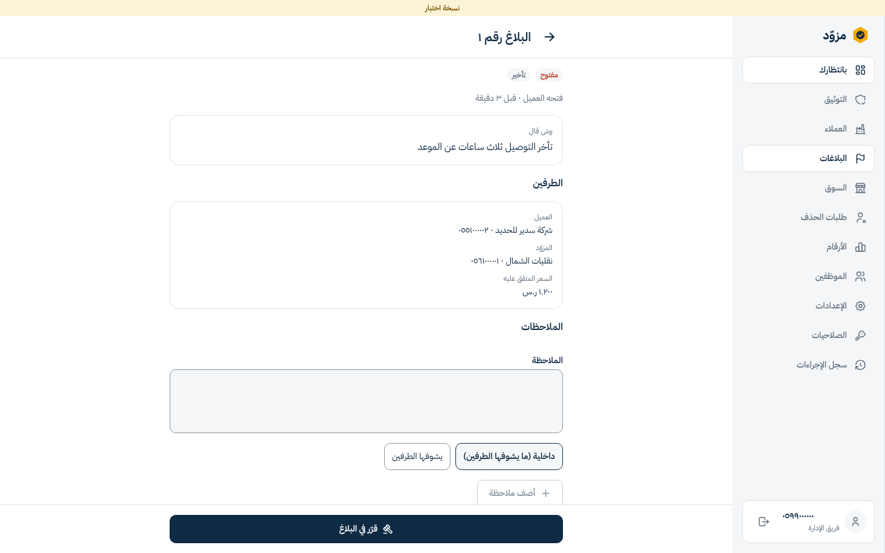

- وش قال صاحب البلاغ، والطرفين وجوالاتهم، والسعر المتفق عليه.
- **الملاحظات:** اكتب ملاحظة واختر «داخلية» (ما يشوفها الطرفين) أو «يشوفها الطرفين».
- **«اقرأ المحادثة»:** محادثة العميل والمزوّد. قراءتك تنسجل باسمك.
- **«قرّر في البلاغ»:** «كمّل التنفيذ» أو «اعتبره مكتمل» أو «ألغِ الطلب»، مع سبب يوصل للطرفين.

الخطوات في [`procedures/handle-dispute.md`](procedures/handle-dispute.md) و[`procedures/read-dispute-chat.md`](procedures/read-dispute-chat.md).

## ٥. السوق

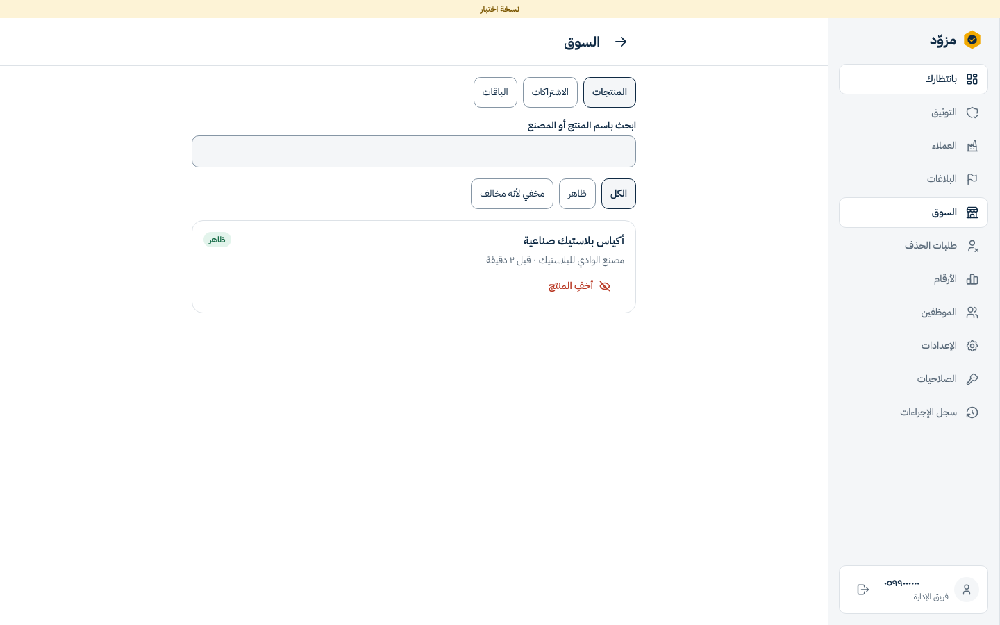

- **المنتجات:** ابحث، و«أخفِ المنتج» المخالف مع السبب (يوصل للمصنع). «رجّع المنتج» يرجّعه مخفي، والمصنع يظهره بعد ما يعدّله. ([`procedures/remove-product.md`](procedures/remove-product.md))
- **الاشتراكات:** كل بائع ونهاية اشتراكه وآخر دفعة. **«سجّل دفعة»** لما يوصل تحويل: الباقة، وعدد الأشهر، والمبلغ، وتاريخ التحويل، ورقم المرجع. لو المبلغ يختلف عن سعر الباقة يطلع لك تنبيه. ([`procedures/record-payment.md`](procedures/record-payment.md))
- **الباقات:** السعر الشهري وأقصى عدد منتجات. التعديل للمدير والمالك، والسعر الجديد للدفعات الجاية بس.

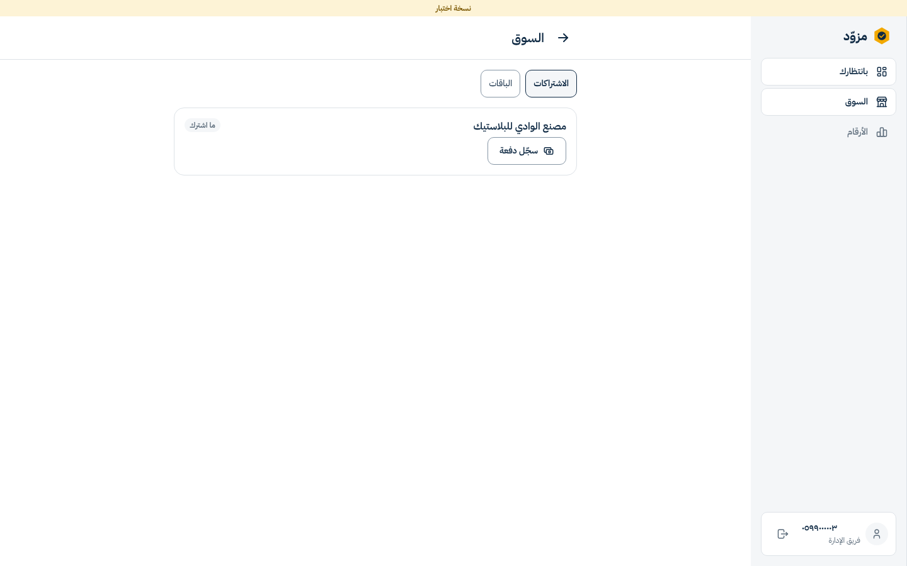

## ٦. طلبات حذف الحساب

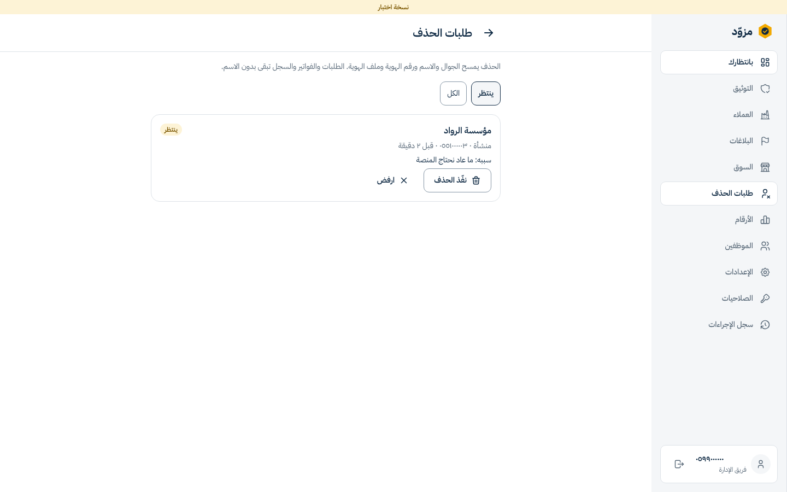

العميل أو المزوّد يطلب الحذف من «حسابي»، ويوصل هنا.
- **«نفّذ الحذف»:** يمسح الجوال والاسم ورقم الهوية وملف الهوية، ويقفل الدخول. **الطلبات والفواتير والسجل والرسائل تبقى بدون الاسم** لأن النظام يطلب حفظها. **ما يتراجع عنه.**
- ما يتنفّذ لو عنده طلب جاري أو بلاغ مفتوح. يطلع لك السبب.
- **«ارفض»** مع سبب، والسبب يطلع له في «حسابي».

الخطوات في [`procedures/process-account-deletion.md`](procedures/process-account-deletion.md).

## ٧. الأرقام

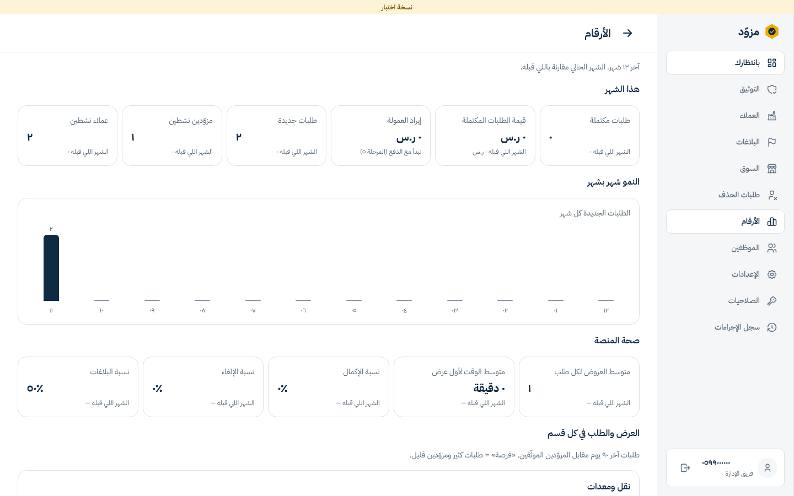

آخر ١٢ شهر، والشهر الحالي مقارنة باللي قبله:
- **هذا الشهر:** الطلبات المكتملة وقيمتها، وإيراد العمولة (يبدأ مع الدفع في المرحلة ٥)، والطلبات الجديدة، والمزوّدين والعملاء النشطين.
- **النمو شهر بشهر:** رسم للطلبات الجديدة.
- **صحة المنصة:** متوسط العروض لكل طلب، ومتوسط الوقت لأول عرض، ونسبة الإكمال والإلغاء والبلاغات.
- **العرض والطلب في كل قسم:** طلبات آخر ٩٠ يوم مقابل المزوّدين الموثّقين. شارة «فرصة» = طلبات كثير ومزوّدين قليل.
- **السوق:** إيراد الاشتراكات، والبائعين المشتركين، وطلبات الشراء.

**كيف تنحسب:** «النشط» = عميل رفع طلب، أو مزوّد أرسل عرض، في الشهر. والنسب على الطلبات اللي انرفعت في الشهر.

## ٨. الموظفين

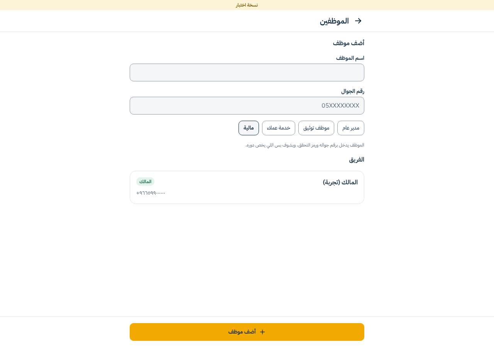

- **إضافة موظف:** اسمه ورقم جواله ودوره، و«أضف موظف».
- **إيقاف موظف:** «أوقف الحساب». يطلع من المنصة فورًا.
- إضافة مدير عام أو إزالته **قرار المالك**. ([`procedures/add-remove-staff.md`](procedures/add-remove-staff.md))

## ٩. الإعدادات

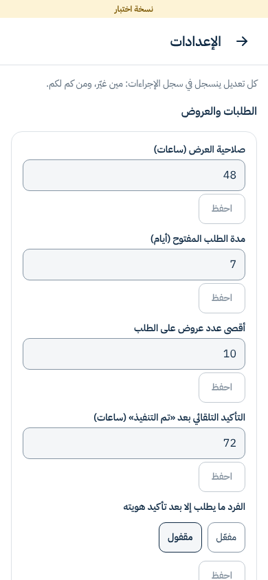

كل قسم له زر «احفظ»، وكل تعديل ينسجل (مين غيّر، ومن كم لكم):
- **الطلبات والعروض:** صلاحية العرض، ومدة الطلب المفتوح، وأقصى عدد عروض، والتأكيد التلقائي، و«الفرد ما يطلب إلا بعد تأكيد هويته».
- **الرسائل النصية:** أي أحداث توصل برسالة (لها تكلفة).
- **رقم «التزم بـ X من Y طلب»:** تشغيله، والمدة، وأقل عدد.
- **السوق:** مين يشتري، والفترة المجانية، ومتى تنفتح الصفحة العامة، والتنبيه قبل الانتهاء، و**العمولة (المالك بس)**.

سياسة رسوم الإلغاء ما تتعدّل من هنا الحين (قرار المالك مع الشريك). الخطوات في [`procedures/change-setting.md`](procedures/change-setting.md).

## ١٠. الصلاحيات (المالك بس)

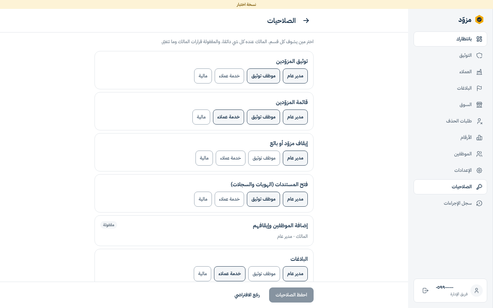

لكل قسم: اختر الأدوار اللي تشوفه، واضغط «احفظ الصلاحيات». ينطبق **فورًا** على كل الموظفين. «رجّع الافتراضي» يرجّع الجدول اللي فوق.
- المالك عنده كل شي دائمًا.
- **المقفولة** ما تتغيّر: تغيير العمولة، وتغيير الصلاحيات، وإضافة الموظفين. هذي قرارات المالك.

الخطوات في [`procedures/change-permissions.md`](procedures/change-permissions.md).

## ١١. سجل الإجراءات

كل إجراء: مين سوّاه، ومتى، والسبب. **ما ينحذف ولا يتعدل.** ارجع له إذا صار خلاف.

## شاشات المزوّد (عشان تعرف وش يشوف)

| قبل الإرسال | بعد التوثيق |
| --- | --- |
|  |  |

## الصور

الصور مأخوذة من المنصة على بيانات تجريبية. لما تتغيّر الشاشات، تنعاد بنفس الطريقة (في `README.md`، قسم «تجربة المزوّد ولوحة الإدارة»).
