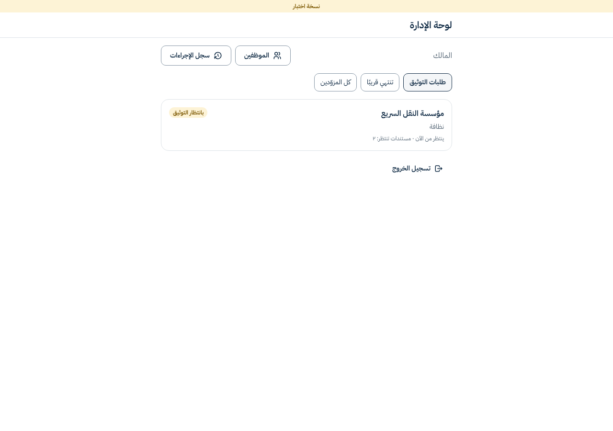
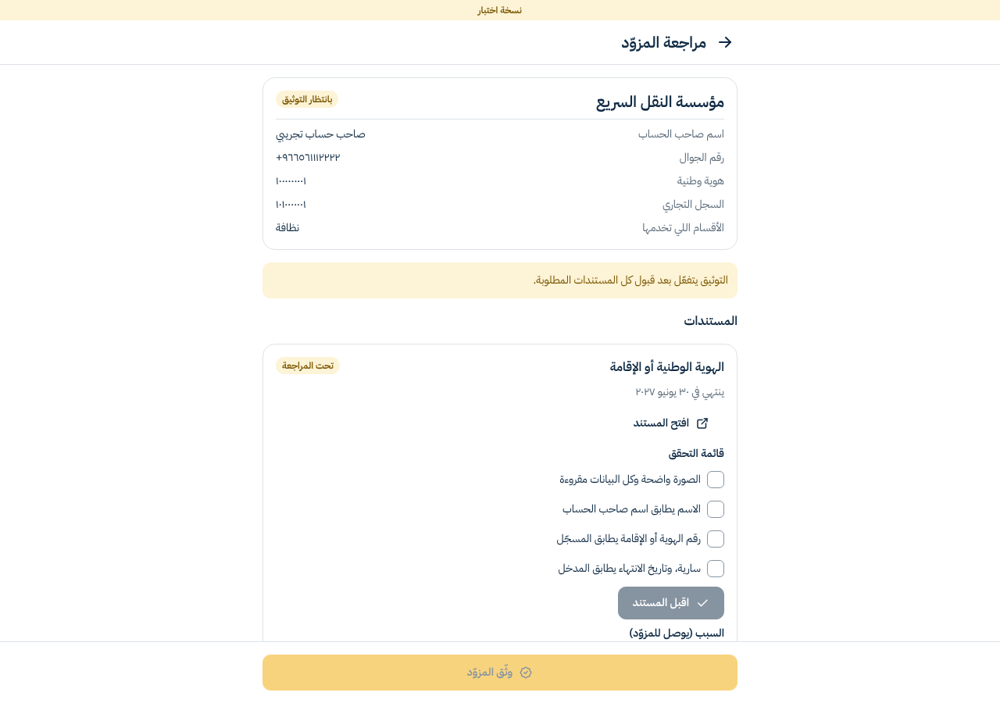
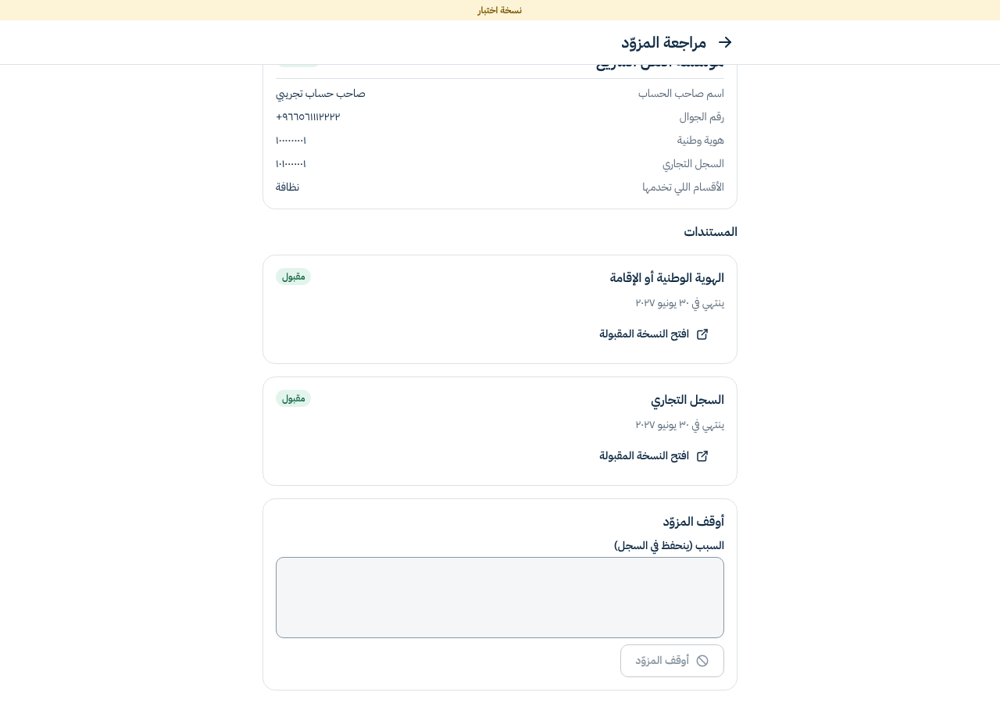
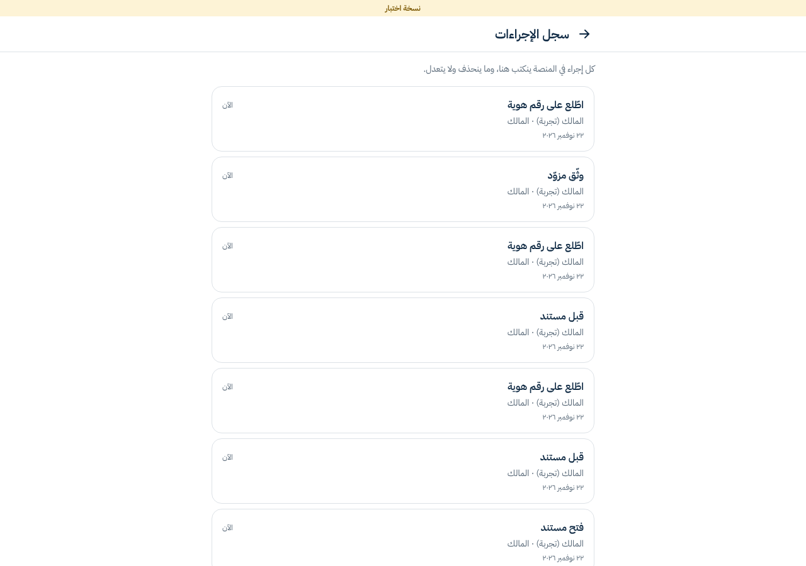
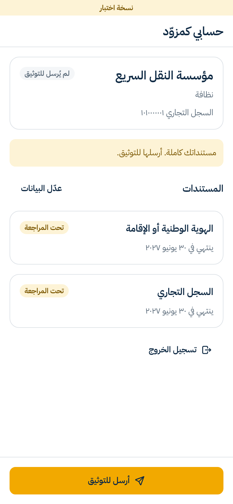
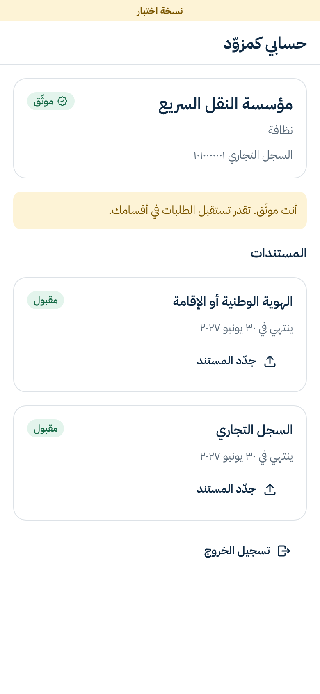

# دليل لوحة الإدارة

**آخر تحديث:** 22 نوفمبر 2026 (المرحلة ٣)

اللوحة على نفس عنوان المنصة، تحت `/admin`. تدخل برقم جوالك ورمز التحقق مثل أي مستخدم، والمنصة تعرف إنك موظف وتوديك للوحة. **كل موظف يشوف بس اللي يخص دوره**، وأي إجراء تسويه ينكتب باسمك في سجل الإجراءات.

> في هذي المرحلة اللوحة فيها: توثيق المزوّدين، والموظفين، وسجل الإجراءات. الطلبات والنزاعات والفواتير والتقارير تجي في المراحل ٤ إلى ٧.

## الأدوار ووش يشوف كل واحد

| الشاشة | المالك | مدير عام | موظف توثيق | خدمة عملاء | مالية |
| --- | --- | --- | --- | --- | --- |
| طلبات التوثيق، والمستندات اللي تنتهي قريبًا | ✓ | ✓ | ✓ | | |
| فتح ملفات المستندات، ورقم الهوية كامل | ✓ | ✓ | ✓ | | |
| كل المزوّدين (بدون المستندات) | ✓ | ✓ | ✓ | ✓ | |
| إيقاف مزوّد ورفع الإيقاف | ✓ | ✓ | | | |
| الموظفين | ✓ | ✓ (ما عدا المدير العام) | | | |
| سجل الإجراءات | ✓ | ✓ | | | |

دور «المالية» ما له شاشات في هذي المرحلة (تجي مع الفواتير في المرحلة ٥).

## ١. الصفحة الرئيسية

فوق: دورك، وأزرار «الموظفين» و«سجل الإجراءات» (إذا دورك يسمح). وتحتها ثلاث قوائم:

- **طلبات التوثيق:** مزوّدين أرسلوا مستنداتهم، أو مزوّد موثّق رفع نسخة مجدّدة من مستند (تظهر بشارة «تجديد»). **الأقدم فوق**، فابدأ من أول واحد.
- **تنتهي قريبًا:** مستندات مزوّدين موثّقين تنتهي خلال ٣٠ يوم أو انتهت. المزوّد نفسه يشوف تنبيه في حسابه، وأنت تقدر تتواصل معه.
- **كل المزوّدين:** كل مزوّد وحالته.

## ٢. مراجعة مزوّد

اضغط على اسم المزوّد. تطلع لك بياناته (الاسم، والجوال، ورقم الهوية، والسجل، والأقسام)، وتحتها مستنداته.

لكل مستند ينتظر:
1. اضغط **«افتح المستند»**. ينفتح في تبويب جديد برابط مؤقت يشتغل ٥ دقايق بس. وكل فتح ينكتب في السجل.
2. قارن المستند بالبيانات، وأشّر على **كل** بنود **قائمة التحقق**.
3. إذا كل شي سليم: **«اقبل المستند»** (ما يتفعّل إلا بعد التأشير على كل البنود).
4. إذا فيه مشكلة: اكتب السبب في خانة «السبب» (يوصل للمزوّد كما هو، فاكتبه واضح ومحترم)، واضغط **«ارفض المستند»**. المزوّد يرفع نسخة جديدة وترجع لك في القائمة.

بعد قبول كل المستندات المطلوبة يتفعّل الزر الكهرماني تحت: **«وثّق المزوّد»**. اضغطه، وتطلع شارة «موثّق» الخضراء جنب اسم المزوّد.

الخطوات بالتفصيل في [`procedures/verify-provider.md`](procedures/verify-provider.md).

## ٣. الموظفين

- **إضافة موظف:** اكتب اسمه ورقم جواله، واختر دوره، واضغط «أضف موظف». يدخل بعدها برقم جواله.
- **إيقاف موظف:** «أوقف الحساب» تحت اسمه. يطلع من المنصة فورًا، وروابط المستندات اللي فتحها تبطل.
- المدير العام يضيف ويوقف كل الأدوار ما عدا المدير العام. إضافة مدير عام أو إزالته **قرار المالك**.
- رقم مسجّل كمصنع أو مزوّد ما يصير موظف. الموظف يحتاج رقم ثاني.

## ٤. سجل الإجراءات

كل إجراء في المنصة: مين سوّاه، ومتى، والسبب لو فيه سبب. **ما ينحذف ولا يتعدل**، حتى من المبرمج (قاعدة البيانات نفسها تمنع). ارجع له إذا صار خلاف: «مين رفض هذا المستند؟ ومتى؟ وليش؟».

## شاشات المزوّد (عشان تعرف وش يشوف)

| قبل الإرسال | بعد التوثيق |
| --- | --- |
|  |  |
